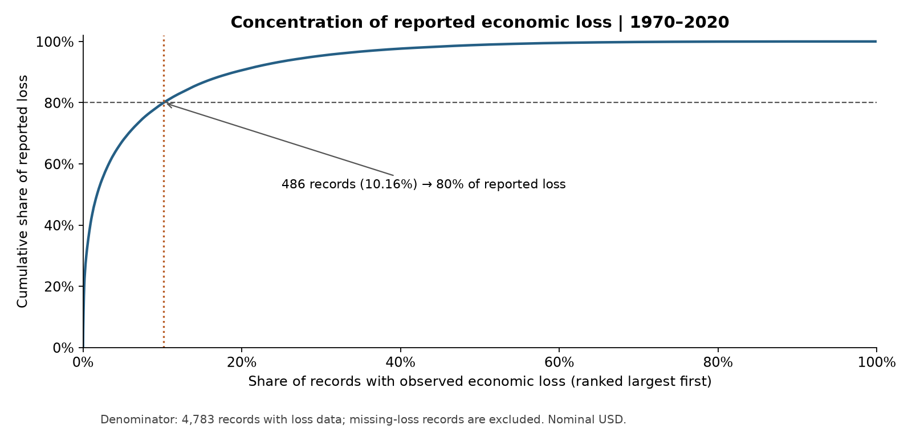

# Global Disaster Analysis

**全球自然灾害记录的分布、经济损失集中度与数据覆盖分析。**

Python · Pandas · NumPy · Matplotlib · Plotly · Jupyter

本项目基于全球自然灾害历史记录，开展数据质量评估、时间与地域分布分析、灾害类型比较及经济损失集中度分析。
数据处理、统计分析、可视化与报告撰写独立完成；每项发现均可追溯到代码、数据定义与计算结果。

## 项目回答什么

1. 灾害记录在时间、类型和地域上如何分布？
2. 少量国家级影响记录贡献了多少已报告经济损失？
3. 大量缺失值如何限制趋势与跨地区比较？

## 核心发现

统一分析 **1970—2020**，包含 **14,329 条国家级灾害影响记录**，涉及 **228 个国家或地区**。
同一跨国灾害可能有多条国家级记录，不能直接把记录数称作独立灾害数。

- 经济损失缺失 **66.62%**，死亡人数缺失 **30.16%**；未知影响不填为零。
- 在 **4,783 条有经济损失数据的记录中**，最大的 **486 条（10.16%）**贡献了已记录损失的 80%。
- 以上为历史快照的描述性结果。损失是名义美元，不据此认定实际风险增长或推断因果关系。



## 查看成果

- [完整中文分析报告](reports/case-study.zh-CN.md)：原始数据结构、清洗流程、八个图表模块及综合讨论。
- [已执行 Notebook](notebooks/disaster_analysis.ipynb)：从读取到汇总、出图的完整流程。
- [离线交互式国家排名](reports/figures/08_country_explorer.html)：下载后用浏览器打开，无需网络。
- [数据来源与获取](docs/DATA.md)、[分析方法](docs/METHODOLOGY.md)。

GitHub 不直接执行 HTML 内的交互脚本；README、报告和 Notebook 中的静态图可直接查看。

## 如何复现

建议使用 Python 3.12。在项目根目录执行：

```bash
python -m venv .venv
source .venv/bin/activate
python -m pip install -r requirements.txt
```

按 [数据说明](docs/DATA.md) 将有权使用的历史 CSV 放入 `data/raw/1970-2021_DISASTERS.csv`，然后执行：

```bash
python -m src.run
python -m unittest discover -s tests -v
python tools/execute_notebook.py
```

可以使用 `python -m src.run --input /path/to/file.csv` 指定其他位置。
输入指纹和精确结果保存在 [summary.json](reports/summary.json)。不同来源版本可能产生不同结果。
原始和逐行清洗数据不随仓库分发；已保存的图表、汇总表与 Notebook 可直接阅读。

## 分析设计

- 对唯一记录编号、必要字段、数值有效性、国家后缀进行验证。
- 频次按记录行数计算，避免名称缺失导致漏计。
- 年份只筛选一次；各图统一使用 1970—2020。
- 未知死亡、受影响人数和损失保持未知；全缺失分组汇总不伪装成零。
- 全球使用日历月，未知月份不填 6 月，不套用统一季节。
- 损失图同时展示覆盖率，集中度明确分母，不输出未经校准的综合严重程度评分。

## 目录

```text
src/          数据校验、指标计算、图表与报告生成
notebooks/    已执行的分析流程
reports/      报告、汇总结果及静态/交互图表
docs/         数据、方法、面试讲解与发布说明
tests/        统计口径与缺失值回归测试
tools/        Notebook 执行及公开包生成
data/raw/     本地输入，Git 忽略，不随发布包分发
```

## 数据来源与限制

课程报告所列来源为 [Kaggle 历史灾害数据集](https://www.kaggle.com/datasets/brsdincer/all-natural-disasters-19002021-eosdis)。
本地快照尚未与线上版本逐字节核验。记录粒度参考 [EM-DAT 官方结构](https://doc.emdat.be/docs/data-structure-and-content/core-structure-of-the-database/)。
数据缺失、历史报告覆盖、分类变化及未调整的价格水平限制了跨国和跨期解读。
本项目是探索性分析，不提供灾害预测或保险定价。
第三方数据按其原条款使用，仓库不另行授予数据分发权；详见 [数据说明](docs/DATA.md)。
