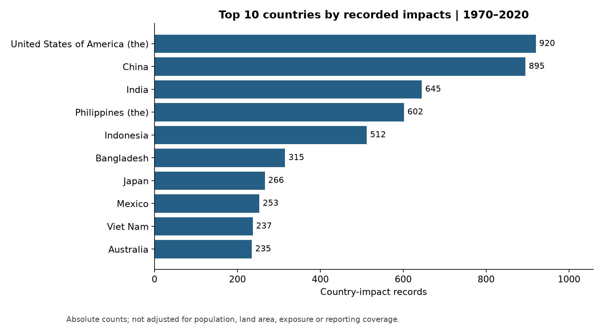

# A Multidimensional Analysis of Global Disaster Records

[Chinese report](case-study.zh-CN.md) · [Project overview](../README.en.md)

## Abstract

This study explores the long-term distribution, geographical differences and economic loss concentration of historical disaster records.
The raw CSV contains **14,644 rows and 47 columns**, covering 1970–2021.
The analysis uses **14,329 country-level disaster impact records from 1970–2020**, spanning **228 countries or territories**.
Because one disaster may affect several countries, country-impact records and distinct event identifiers are counted separately.

Floods and storms account for **63.05%** of records, and Asia has the largest record count.
Reported economic loss is concentrated in a small subset of records, but **66.62%** of loss values are missing.
Loss totals and concentration therefore describe reported observations, not all unobserved impacts.
Data quality is part of the analysis: field completeness, group-level coverage and metric scope are presented alongside the findings.

## 1. Background and Research Questions

Disaster records reflect both natural events and the processes through which countries collect, assess and report impacts.
Counts alone cannot distinguish frequently recorded hazards from those associated with large losses.
Comparing monetary totals alone can overlook differences in reporting completeness across countries and disaster types.
The study addresses three related questions:

1. **Distribution:** How do record counts differ across years, months, countries and disaster types?
2. **Impact:** Which types, regions and country-impact records account for reported economic loss?
3. **Data fitness:** Which fields are incomplete, and which comparisons are sensitive to reporting coverage and metric definitions?

Python, Pandas and NumPy support loading, validation and aggregation. Matplotlib supplies analytical figures, while Plotly provides an interactive country ranking.
The study is descriptive: its focus is reproducible statistical observations and the limits of their interpretation.

## 2. Understanding the Raw Data

### 2.1 Source, Scale and Unit of Observation

The recorded source is [ALL NATURAL DISASTERS 1900-2021 / EOSDIS on Kaggle](https://www.kaggle.com/datasets/brsdincer/all-natural-disasters-19002021-eosdis).
The local input is `1970-2021_DISASTERS.csv`. Its actual contents define the available dates and schema;
the online dataset title does not establish that this local file includes all records since 1900.
The input SHA-256 fingerprint is recorded in [summary.json](summary.json).
The local snapshot has not been compared byte-for-byte with the current online download.

The file is a wide table. Each row describes one disaster's impact in one country; columns hold identifiers, classifications, location, timing and impact measures.
`Dis No` follows a `year-event sequence-country code` pattern. A cross-border disaster can have multiple country-specific rows.
Removing the country suffix yields **12,660 distinct event identifiers**, compared with 14,329 country-impact records in the analysis window.
All frequency charts in this report consistently use country-impact records.

### 2.2 Field Structure

| Field group | Representative fields | Analytical role |
|---|---|---|
| Identifiers and classification | `Dis No`, `Disaster Group`, `Disaster Type`, `Disaster Subtype`, `Event Name` | Uniqueness checks, grouping and traceability |
| Country and geography | `Country`, `ISO`, `Region`, `Continent`, `Location`, latitude and longitude | Country and continent comparisons |
| Timing | `Year`, start and end year/month/day | Study window, annual trends and month distribution |
| Human impacts | `Total Deaths`, `No Injured`, `No Affected`, `No Homeless`, `Total Affected` | Completeness assessment and reported impact totals |
| Economic impacts | Total damages, insured damages, reconstruction costs, `CPI` | Nominal reported losses and limits on comparisons over time |
| Response and contextual information | `Appeal`, `Declaration`, aid contributions, associated disasters, administrative codes | Context; not the main comparative metrics |

On import, 28 fields have text-like types; the remaining fields are integer or floating-point columns.
A floating-point column does not necessarily represent a continuous measurement. Integer concepts such as months and people counts may be stored as floats when values are missing.
For example, `Start Month = 7.0` means July, not a time measurement with decimal precision.

### 2.3 Illustrative Table Layout

The following rows are **constructed examples, not actual disaster records**. They illustrate the schema and the meaning of missing values.

| Dis No | Year | Disaster Type | Country / ISO | Start Month | Total Deaths | Total Damages ('000 US$) |
|---|---|---|---|---|---|---|
| 2000-0001-AAA | 2000 | Flood | Example country A / AAA | 7 | 12 | 25000 |
| 2000-0001-BBB | 2000 | Flood | Example country B / BBB | 7 | Missing | 8000 |
| 2000-0002-AAA | 2000 | Storm | Example country A / AAA | Missing | 0 | Missing |

The first two rows represent the same event affecting two countries. The third row explicitly records zero deaths;
the second row has an unknown death count. These states are not interchangeable.
Economic loss is measured in **USD thousands**: 25000 in the example means USD 25 million.
`Event Name` is optional: **10,999 raw records (75.11%)** have no name.
It can help identify events but cannot reliably count all records.

### 2.4 Completeness of the Raw Fields

The six most incomplete fields in the 14,644-row raw file are shown below.
Although the table has many columns, the information available in them varies considerably.

| Raw field | Missing records | Share of raw dataset |
| --- | --- | --- |
| Reconstruction Costs ('000 US$) | 14,613 | 99.79% |
| Aid Contribution | 13,967 | 95.38% |
| Associated Dis2 | 13,946 | 95.23% |
| Local Time | 13,879 | 94.78% |
| Disaster Subsubtype | 13,600 | 92.87% |
| Insured Damages ('000 US$) | 13,550 | 92.53% |

Reconstruction costs and aid contributions appear in only a small subset of records and do not support straightforward comparisons across all countries or types.
The principal analysis therefore uses identifiers, year, geographical groups, disaster type, main impact measures and start month.
The raw fields remain available locally; incomplete records are not indiscriminately filled or removed merely to produce a table without nulls.

## 3. Data Cleaning and Metric Construction

### 3.1 Processing Workflow

The sequence is: **load → check schema → standardize text → parse numbers → select years → validate identifiers and grouping keys → validate impacts and months → derive analytical fields**.

| Step | Rule | Purpose |
|---|---|---|
| Required fields | Require identifiers, year, country, continent, disaster type and main impact fields | Detect incompatible input schemas |
| Text normalization | Trim leading/trailing whitespace; treat empty strings as unknown | Prevent labels such as `Extreme temperature` from splitting into separate categories |
| Numeric parsing | Explicitly parse year, month, deaths, affected people and loss; reject nonempty unparseable values | Prevent silent numerical errors |
| Time selection | Use 1970–2020 consistently | Maintain one population; do not compare unverified 2021 coverage as if complete |
| Identifier checks | Require present, unique country-impact IDs with ISO-consistent suffixes | Maintain traceability and consistent grouping |
| Impact checks | Reject negative or infinite impact values | Exclude invalid numerical states from aggregation |
| Month checks | Accept only integers from 1 to 12; preserve unknowns and flag invalid months | Avoid creating artificial monthly peaks |
| Derived fields | Extract `Event_ID`, derive `Decade`, flag invalid months | Check observation grain and aggregate time periods |

Of 14,644 input records, **315** fall outside the study window, leaving 14,329.
There are **0 exact duplicate rows** in the raw input; the selected country-impact IDs pass the uniqueness check.
The selected data has **0 invalid months** and **266 unknown valid-month values**.
Records with missing impacts remain in the population for record-count analysis.

### 3.2 Missing-Value Policy

Unknown human and economic impacts remain missing. An absent report does not establish a zero impact;
zero-filling would affect totals, averages and the apparent proportion of records with no casualties.
Only the monthly chart excludes records without a valid start month. Those records still contribute to annual, type and country counts.

Two sample definitions are used explicitly: **counts use all country-impact records; monetary statistics use records with observed loss**.
A group with no observed losses has an unknown total, not zero. A partially observed group has a reported sum together with its coverage rate.
The sum of known amounts must not be interpreted as the complete true loss.

### 3.3 Metric Definitions

| Metric | Calculation | Denominator or unit |
|---|---|---|
| Country-impact record count | Count each unique country-impact row | Records, including unnamed rows |
| Record share | Group count / corresponding population | Population specified in each section |
| Loss coverage | Nonmissing loss records / all group records | Percentage; observed zeros count as known |
| Reported loss | Sum observed monetary values | Input: USD thousands; figures: USD billions |
| Loss concentration | Minimum descending-rank count reaching 80% of loss / observed-loss record count | Observed-loss sample only |
| Monthly share | Records in a start month / records with valid start month | Unknown months excluded |

Monetary values are not inflation-adjusted. The raw file contains CPI, but its reference basis and conversion have not been sufficiently verified for this analysis.
Losses therefore retain their nominal interpretation. Large observations remain in the analysis because concentration concerns the tail of the distribution.
A high value warrants verification; magnitude alone does not justify deleting it as an error.

## 4. Analysis by Module

### 4.1 Time: How Record Counts Change

**Reading the figure.** The horizontal axis is year; the vertical axis is the number of country-impact records.
Each point includes all records in that year, rather than only named events or records with known loss or deaths.

**Findings.** Counts are comparatively low in the 1970s, rise in subsequent decades and reach the window's maximum of
**532 in 2002**. They remain relatively high after 2000 but do not increase every year.
Complete ten-year periods distinguish the longer-term pattern from annual fluctuations:

| Period | Records | Annual average |
| --- | --- | --- |
| 1970–1979 | 911 | 91.1 |
| 1980–1989 | 1,801 | 180.1 |
| 1990–1999 | 2,975 | 297.5 |
| 2000–2009 | 4,476 | 447.6 |
| 2010–2019 | 3,768 | 376.8 |

**Interpretation.** The 2000–2009 period has more records than the other complete decades; 2010–2019 has fewer than the preceding decade.
The full series therefore cannot be characterized as a continuous, monotonic rise in disaster frequency.
There is a clear difference between earlier and later recorded counts, alongside substantial variation within the later period.

**Limits.** Counts reflect hazard occurrence, the number of countries affected, historical documentation and reporting systems.
Without evidence of comparable reporting coverage, this curve cannot identify the effect of climate change or attribute later declines to prevention policies.
The single year 2020 is not compared with complete decade totals.

### 4.2 Disaster Types: Frequent Records and Large Losses

**Reading the figure.** Disaster types are ordered by record count. Low-frequency categories remain visible so the distribution does not appear to contain only common hazards.

| Disaster type | Records | Record share | Loss coverage | Reported loss (USD billions) |
| --- | --- | --- | --- | --- |
| Flood | 5,112 | 35.68% | 33.59% | 872.55 |
| Storm | 3,922 | 27.37% | 52.35% | 1,587.51 |
| Epidemic | 1,431 | 9.99% | 0.00% | Unknown |
| Earthquake | 1,118 | 7.80% | 42.58% | 828.91 |
| Landslide | 703 | 4.91% | 12.09% | 10.99 |
| Drought | 675 | 4.71% | 28.15% | 183.90 |
| Extreme temperature | 582 | 4.06% | 11.00% | 62.65 |
| Wildfire | 436 | 3.04% | 35.32% | 118.89 |
| Volcanic activity | 214 | 1.49% | 16.82% | 4.74 |
| Insect infestation | 93 | 0.65% | 5.38% | 0.23 |
| Mass movement (dry) | 41 | 0.29% | 4.88% | 0.01 |
| Animal accident | 1 | 0.01% | 0.00% | Unknown |
| Impact | 1 | 0.01% | 100.00% | 0.03 |

**Findings.** Floods and storms account for **63.05%** of all records.
Their prominence in counts does not imply the same ordering in monetary loss: storms have larger reported total losses than floods.
Earthquakes have far fewer records but reported losses approaching the flood total.

**Interpretation.** Frequency describes how often a category appears in the country-impact data; reported loss describes the scale of known monetary impacts.
Considering both is more informative than using a single label such as “most common” or “most severe.”

**Limits.** Coverage varies across types. Epidemics have no observed monetary loss in this window, so their total is unknown, not zero.
Categories with little reported information cannot be directly ranked against better-covered categories as measures of true economic harm.
Human-impact completeness also differs, making unadjusted average deaths per record insufficient for a general lethality ranking.

### 4.3 Data Quality: Which Impacts Are Documented?

**Reading the figure.** Each bar measures the share of all 14,329 records missing that particular field.

| Field | Observed records | Missing records | Missing share |
| --- | --- | --- | --- |
| Total Deaths | 10,008 | 4,321 | 30.16% |
| Total Affected | 10,771 | 3,558 | 24.83% |
| Total Damages ('000 US$) | 4,783 | 9,546 | 66.62% |
| Start Month | 14,063 | 266 | 1.86% |

**Findings.** Economic loss is the most incomplete of these four fields: only 4,783 records support monetary analysis.
Deaths and affected-person counts also have material gaps, while start month is relatively complete.
Record distribution and impact distribution therefore have different effective sample sizes.

**Interpretation.** Missingness continues to affect interpretation after cleaning.
A region with many records but low loss coverage need not have a proportionately large reported monetary total.
The absence of monetary information for a category does not establish that its economic effects are small.

**Limits.** The study does not establish that missingness is random, and observed-loss records are not assumed to be an unbiased sample of all records.
No blanket mean imputation is applied. Estimating unreported loss would require additional evidence, assumptions about missingness and sensitivity analysis.

### 4.4 Loss Structure: Concentration in a Small Subset

**Reading the figure.** Observed-loss records are ranked from largest to smallest monetary amount.
The horizontal axis is their cumulative record share; the vertical axis is their cumulative share of reported loss.
A curve that approaches the upper boundary early indicates concentration. The reference lines identify the 80% threshold and the minimum record share reaching it.

**Findings.** Among **4,783 country-impact records with observed loss**, the largest **486 (10.16%)**
account for 80% of reported loss. Many smaller records supply most of the count, while a small number of large amounts dominate the total.

**Interpretation.** Means are sensitive to the tail of this distribution. Totals and averages should be considered alongside concentration, quantiles and the context of large observations.
The concentration pattern can guide further verification and scenario analysis, but it does not determine an optimal allocation of resources.

**Limits.** The denominator is the observed-loss sample, not all 14,329 records or the deduplicated set of global event IDs.
Observed zero losses remain in the denominator; unknown losses do not.
The result must not be shortened to “10% of global disasters cause 80% of all losses.”
Ranking uses nominal dollars, so price differences across decades may also affect the precise concentration estimate.

### 4.5 Economic Impact: Annual Loss and Reporting Coverage

**Reading the figure.** The upper panel shows annual reported loss in USD billions.
The lower panel shows the share of each year's records with known loss. Their shared time axis puts amounts and completeness in context.

**Findings.** The highest total occurs in **2011 at approximately USD 364.10 billion**;
another prominent peak is **2017 at USD 326.08 billion**.
The series has sharp peaks rather than smooth growth, which is compatible with the concentrated loss distribution.
This is statistical compatibility, not event-by-event verification of what caused each peak.

Coverage also varies: it reaches only **16.06% in 2019**.
The reported amount in that year comes from a small subset of records. A lower total under limited coverage does not establish a lower true impact.

**Interpretation.** Amounts and coverage should be read together. High-loss years call for examination of observed records, disaster-type composition and extreme values.
Comparisons over time require controls for prices, asset exposure and reporting completeness.

**Limits.** These are nominal reported totals, not complete global losses, constant-price estimates or losses per unit of exposed assets.
The chart does not attribute increases to physical hazard intensity or decreases to risk-management effectiveness.

### 4.6 Calendar Months: When Records Begin

**Reading the figure.** Records are grouped by start month. The valid-month sample contains 14,063 records;
266 records with unknown months are excluded from this chart.

| Start month | Records | Share of records with a valid month |
| --- | --- | --- |
| 1 | 1,591 | 11.31% |
| 2 | 926 | 6.58% |
| 3 | 912 | 6.49% |
| 4 | 997 | 7.09% |
| 5 | 1,102 | 7.84% |
| 6 | 1,188 | 8.45% |
| 7 | 1,476 | 10.50% |
| 8 | 1,490 | 10.60% |
| 9 | 1,252 | 8.90% |
| 10 | 1,150 | 8.18% |
| 11 | 958 | 6.81% |
| 12 | 1,021 | 7.26% |

**Findings.** January has the highest count, at 1,591. July and August are also comparatively high, with 1,476 and 1,490 records.
January's three largest categories are storm (382), flood (372), epidemic (352). The peak combines different disaster types and cannot be attributed to one weather process from the aggregate alone.

**Interpretation.** Monthly patterns are a starting point for segmentation by country, latitude or disaster type.
The global distribution combines climate zones, hemispheres and hazards; it does not by itself establish a stable local seasonal pattern.

**Limits.** Seasons differ between hemispheres, so June–August is not labeled a universal global summer.
Start-month conventions for slow-onset hazards may also differ from those for sudden events; no climatic mechanism is tested here.
Counts are not normalized by the number of days in each month and should not be read as daily occurrence rates.

### 4.7 Geography and Type: Differences Across Continents

**Reading the figure.** Rows are disaster types, columns are continents and cells contain country-impact counts.
Color intensity and printed values show absolute counts. Zero means no record for that combination in this snapshot.

| Continent | Records | Record share | Reported loss share | Loss coverage |
| --- | --- | --- | --- | --- |
| Asia | 5,675 | 39.60% | 43.51% | 37.60% |
| Americas | 3,421 | 23.87% | 41.87% | 38.97% |
| Africa | 2,763 | 19.28% | 1.01% | 10.64% |
| Europe | 1,821 | 12.71% | 10.98% | 39.32% |
| Oceania | 649 | 4.53% | 2.64% | 47.15% |

**Findings.** Asia has the highest total count; its **2,103 flood records** form the largest cell.
Africa's **856 epidemic records** are prominent in the type–continent comparison.
Europe has **272 extreme-temperature records**, illustrating differences in category composition.
Reported loss shares do not simply track record shares: Asia and the Americas account for much larger monetary shares than Africa.

**Interpretation.** The heatmap identifies region–type combinations for further investigation.
The accompanying table places record counts, monetary shares and coverage together.
Africa's low loss coverage is a particular reason not to interpret its small reported monetary share as evidence of low true economic risk.

**Limits.** Counts are not normalized by the number of countries, population, land area or asset exposure.
More records do not necessarily imply greater individual risk. Geographical names and categories follow the historical snapshot;
an empty combination is not proof that the hazard cannot occur there.

### 4.8 Countries: Record Rankings Versus Monetary Rankings

The [interactive country ranking](figures/08_country_explorer.html) covers the top twenty by record count, with loss coverage and reported amounts available on hover.
The HTML bundles its plotting library and can be downloaded for offline viewing. The table below supplies key values without requiring interaction.

| Country or territory | Records | Loss coverage | Reported loss (USD billions) |
| --- | --- | --- | --- |
| United States of America (the) | 920 | 60.98% | 1,177.16 |
| China | 895 | 60.00% | 583.20 |
| India | 645 | 27.75% | 137.26 |
| Philippines (the) | 602 | 58.97% | 28.45 |
| Indonesia | 512 | 26.37% | 33.71 |
| Bangladesh | 315 | 13.65% | 21.54 |
| Japan | 266 | 45.86% | 519.60 |
| Mexico | 253 | 35.18% | 53.87 |
| Viet Nam | 237 | 55.70% | 23.33 |
| Australia | 235 | 72.77% | 61.19 |

**Findings.** The United States, China and India have the three highest record counts:
920, 895 and 645, respectively.
The three largest reported monetary totals instead belong to the United States, China and Japan, together accounting for **62.12%** of reported loss.
Japan is outside the top three by count but ranks among the highest by amount, demonstrating that the two rankings measure different aspects of impact.

**Interpretation.** Country comparisons need at least three measures: record count, reported amount and coverage.
Count describes how many country-level impacts appear; the total describes the known monetary component; coverage shows how broadly that monetary component is documented.
Together they are more informative than a single ranking.

**Limits.** This is not a ranking of the most dangerous countries, per-capita loss or risk relative to GDP.
Asset prices, territory size, population and historical reporting capacity affect the observations.

## 5. Discussion and Further Analysis

### 5.1 Consider Frequent Impacts and Tail Losses Together

Floods and storms dominate record counts, while a small number of large records dominate reported monetary amounts.
Analysis should distinguish recurring impacts from large tail losses, then segment both by region and disaster type.
Neither frequency nor average loss alone captures the full structure visible in this dataset.

### 5.2 Treat Coverage as a Condition for Interpretation

More than six in ten loss values are missing, with differences across types, regions and years.
The analysis describes reported impacts but cannot recover all unknown losses from this table alone.
Extensions could use coverage strata, stable reporting samples across periods and sensitivity analysis of missing-data assumptions.

### 5.3 Build Comparable Risk Measures with Additional Data

Questions such as “where is risk higher?” and “are real losses increasing?” require population, land area, asset stocks, price indices and reporting-system information.
Amounts over time need a clearly specified price base; geographical comparisons need exposure denominators appropriate to the question.
Causal explanations require a suitable research design rather than an interpretation of trend lines alone.

## 6. Conclusion

The 14,329 country-impact records from 1970–2020 show substantial differences across time, geography and disaster type.
Floods and storms dominate recorded frequency, Asia has the largest record count, and reported losses are concentrated at both the country and individual-record levels.
Missing economic values, historical reporting differences and nominal prices mean these findings describe the structure of historical records,
rather than a complete ranking of true global risk or evidence of causal change.

Retaining identifiers, separating unknown values from zeros and presenting coverage alongside amounts keeps the analysis grounded in consistent populations and metric definitions.

## References

- [Kaggle: ALL NATURAL DISASTERS 1900-2021 / EOSDIS](https://www.kaggle.com/datasets/brsdincer/all-natural-disasters-19002021-eosdis)
- [EM-DAT: Core Structure of the Database](https://doc.emdat.be/docs/data-structure-and-content/core-structure-of-the-database/)
- [EM-DAT: Public Table and Field Definitions](https://doc.emdat.be/docs/data-structure-and-content/emdat-public-table/)
- [EM-DAT: Caveat of Missing Data](https://files.emdat.be/docs/20240725%20Caveat%20of%20missing%20data%20in%20EM-DAT.pdf)

Run `python -m src.run` to reproduce the analysis. Chart aggregates are in [tables](tables/);
the input fingerprint, study window and principal metrics are in [summary.json](summary.json).
Raw and row-level processed data are not distributed; use the source dataset under its applicable terms.
