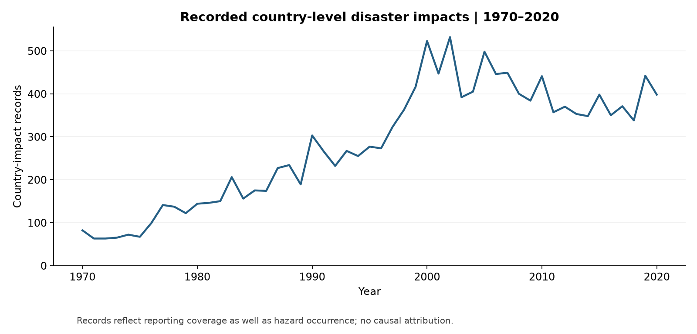
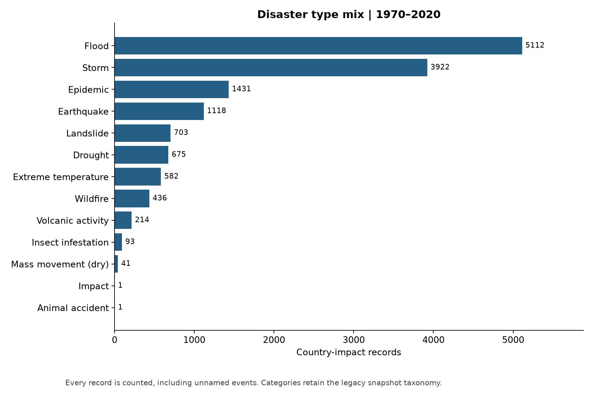
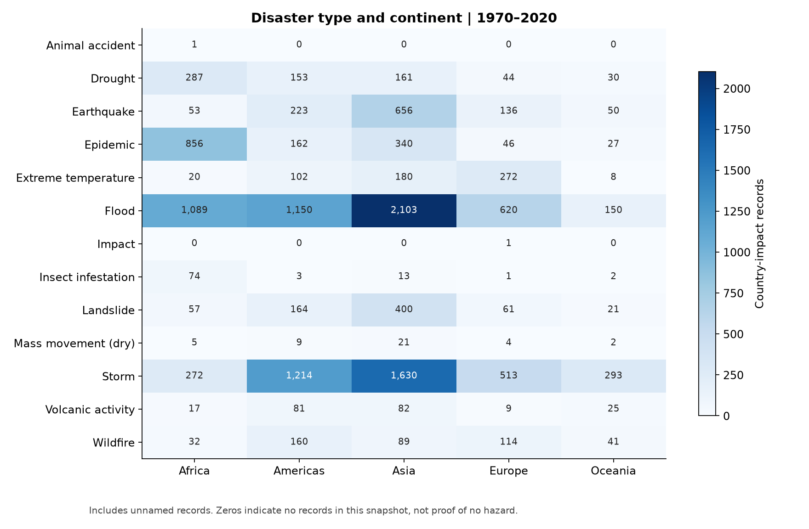
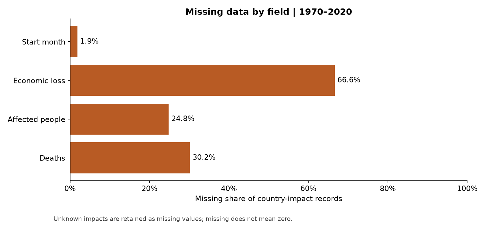
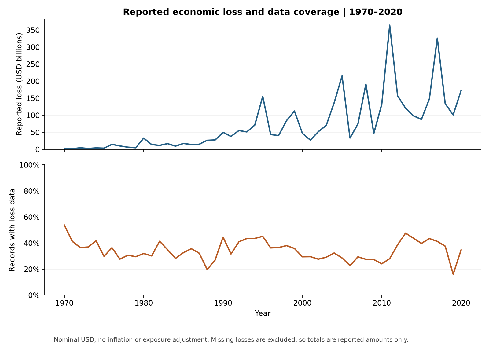
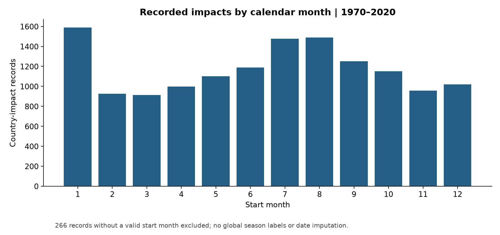

# 全球自然灾害记录：分布、损失与数据覆盖

分析窗口为 **1970—2020**。本地课程数据共 14,644 行，
窗口内包含 **14,329 条国家级灾害影响记录**，涉及 228 个国家或地区。
编号去除国家后缀后有 12,660 个不同灾害编号；全文频次指标均以国家级记录为单位。
2021 年记录统一排除，因为该历史快照的年度完整性未经确认。

## 分析问题

1. 已记录灾害的时间、类型与地域分布如何？
2. 经济损失是否集中于少量国家级影响记录？
3. 缺失数据对这些结论造成哪些限制？

## 主要发现

- 按记录数排序，Flood（5,112 条）与
  Storm（3,922 条）位居前列。
- 经济损失缺失比例为 **66.62%**，死亡人数缺失比例为 **30.16%**。
  未知不等于零；跨国和跨年比较需同时看覆盖率。
- 在 **4,783 条有经济损失记录的样本中**，最大的 **486 条（10.16%）**
  贡献了已记录经济损失的 80%。这是对有记录损失样本的描述，不能外推为全部全球灾害的损失集中度。

## 记录分布

记录数量变化包含报告制度和资料覆盖的影响，不能仅由这条曲线推断灾害物理频次变化。

地区数量未经人口、面积、资产规模归一化，不是地区风险率。
[交互式国家排名](figures/08_country_explorer.html)提供国家记录数、已记录损失和损失覆盖率的悬停查看。

## 数据覆盖与损失集中度

集中度结果提示，应同时关注高频灾害和少量高损失记录。它不能直接给出资源配置比例或保险定价。

经济损失单位为名义美元，原始字段单位为千美元，趋势图换算为十亿美元。
未调整通胀、资产暴露或报告覆盖变化，因而不据此声称实际经济风险以同样幅度上升。

266 条缺少有效开始月份的记录不参与月份统计。
全球南北半球季节相反，因此使用月份，不把全球 6—8 月直接称为夏季。

## 方法与边界

- 使用唯一国家级编号验证重复记录；保留事件编号，不因名称缺失丢弃记录。
- 标准化类别首尾空格；保留死亡、受影响人数及经济损失的缺失值。
- 聚合总额使用 `sum(min_count=1)`，全缺失分组仍为未知。
- 不再输出未经校准的综合严重程度分数，也不通过不完整日期估算精确持续时间。
- 仅作描述性分析，不做因果识别、预测或显著性检验；历史快照不代表最新灾情。
- 数据来源、获取及使用限制见 [数据说明](../docs/DATA.md)；修订内容见 [方法修订](../docs/METHODOLOGY.md)。

## 来源

- [课程报告所列 Kaggle 数据集](https://www.kaggle.com/datasets/brsdincer/all-natural-disasters-19002021-eosdis)
- [EM-DAT 国家级记录结构](https://doc.emdat.be/docs/data-structure-and-content/core-structure-of-the-database/)
- [EM-DAT 缺失数据说明](https://files.emdat.be/docs/20240725%20Caveat%20of%20missing%20data%20in%20EM-DAT.pdf)

本报告源于课程项目的个人作品集整理版。数据记录仍受原来源使用条件约束。
